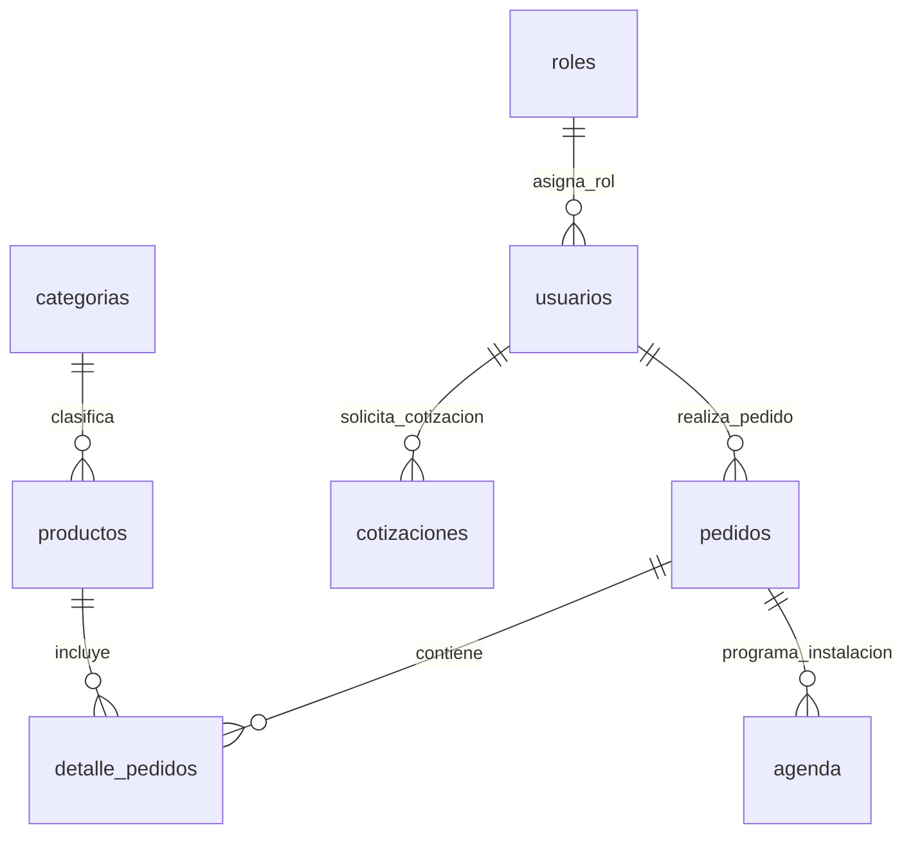

# 🗄️ Arquitectura y Modelo de Base de Datos - Anglo Electric

Este directorio contiene la especificación completa del modelo relacional de base de datos para el proyecto **Capstone (Anglo Electric)**, alojado e implementado en **Neon PostgreSQL**.

---

## 📌 Descripción General

La base de datos fue diseñada para dar soporte al e-commerce y dimensionador solar fotovoltaico, gestionando usuarios, roles, catálogo de productos solares, pedidos, cotizaciones personalizadas y agendamiento de instalaciones.

---

## 🛠️ Tecnologías Utilizadas

* **Motor de Base de Datos:** PostgreSQL
* **Proveedor Cloud:** Neon Serverless Postgres
* **Gestión de Versiones:** Git / GitHub
* **Lenguaje:** SQL (DDL / DML)

---

## 📊 Estructura de Tablas Relacionales

El modelo cuenta con **8 tablas principales** interconectadas mediante relaciones de integridad referencial:

1. `Roles`: Definición de permisos y niveles de acceso (Ej: Administración, Cliente).
2. `Usuarios`: Registro de usuarios con contraseña encriptada (`password_hash`), teléfono y vinculación con rol.
3. `Categorías`: Clasificación de productos (Paneles solares, Inversores, Baterías, Kits completos, etc.).
4. `Productos`: Inventario de equipos fotovoltaicos con especificaciones técnicas (potencia en Watts, precio, stock, imagen y distinción de kits).
5. `Pedidos`: Registro de compras realizadas por los usuarios y seguimiento del estado del pedido.
6. `Detalle_Pedidos`: Tabla intermedia que vincula los productos comprados dentro de cada pedido con sus precios unitarios.
7. `Cotizaciones`: Solicitudes de presupuesto basadas en consumo energético mensual (`kwh`), ubicación geográfica (`comuna`) y estimaciones.
8. `Agenda`: Coordinación de fechas de instalación asignadas a los pedidos finalizados.

---

📐 Diagrama Entidad-Relación (Mermaid)

---

## 🖼️ Esquema Gráfico DBML

El diseño gráfico del modelo entidad-relación está disponible en formato visual:

---

## 🧪 Pruebas e Integración (Postman)

En el directorio `database/` se encuentra el archivo `Postman_collection.json`, el cual contiene las peticiones HTTP (GET y POST) precargadas para probar el consumo de la API conectada a Neon PostgreSQL.
